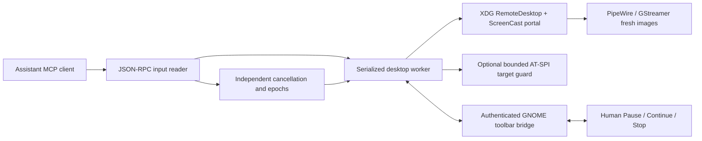

# Architecture

`desktop.py` contains stdio transport, portal lifecycle, held-key release, input dispatch, capture fences and recovery ledger. A separate reader can cancel operations while a serialized worker is busy. Control epochs reject stale queued work and suppress invalidated images before publication. Published images cannot be retracted.

`toolbar_bridge.py` binds the backend to the extension using a session nonce, sender ownership and monotonic sequences. Human buttons signal cancellation independently of the desktop worker. Backend loss or uncertain closure is surfaced rather than silently continuing. The toolbar rectangle is excluded from assistant input.

`target_guard.py` uses explicit public accessibility D-Bus calls. It does not initialize a libatspi cache, subscribe to accessibility events, or read accessible names/text/value/selection. Before keyboard presses it verifies identity, state, geometry and focus. Tokens expire after 60 seconds, are one-use, and are invalidated by any other observation, input, Pause or Stop. Guarded text is limited to 32 characters. Checks are best effort, not atomic with OS dispatch.

`task_continuation.py` is a pure foreground continuation helper. It does not schedule work or wake an idle model. The backend stores only nonsecret task checkpoints in memory; restart loses them.

Capture uses a dropping 5 fps PNG pipeline, a 350 ms settling fence and a 750 ms maximum frame age. These are freshness checks, not proof that an asynchronous application has finished. Input dispatch is bounded at 15 seconds, but blocking OS calls can delay emergency cleanup. Stop cannot undo effects already delivered.
